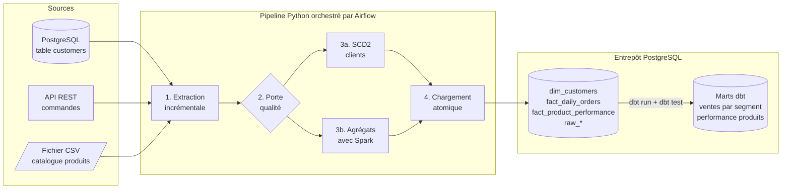

# Pipeline de données automatisé avec Spark, dbt et Airflow

Ce projet est un pipeline ETL de données automatisé qui remplace le traitement manuel quotidien d’une entreprise e-commerce. Il consolide trois sources hétérogènes : une base clients, une API de commandes et un fichier catalogue produits. Il les unifie dans un modèle de données cohérent, prêt pour l’analyse.

---

## Ce que fait le pipeline



1. **Extraction incrémentale** des 3 sources, en parallèle : seuls les enregistrements nouveaux ou modifiés depuis la dernière exécution sont lus (watermarks).
2. **Porte qualité** : valeurs manquantes, types, doublons, e-mails, valeurs autorisées, bornes, cohérence des montants. Si une table est en échec, rien n'est chargé.
3. **Transformations** : historisation SCD2 des clients (pandas) et agrégats de commandes (Spark).
4. **Chargement atomique** dans PostgreSQL : tout est écrit dans une seule transaction (COMMIT ou ROLLBACK).
5. **dbt** construit les tables d'analyse (dont une jointure « point-in-time » sur l'historique client) et les teste.
6. **Rapport** de qualité et d'exécution, alertes en cas d'échec, nettoyage des fichiers temporaires.

Chaque étape sauvegarde son résultat (checkpoint) : après une panne, la relance repart de l'étape qui a échoué, sans ré-extraire les données.

---

## Résultats vérifiés

| Vérification | Résultat |
|---|---|
| Tests automatisés (dans le conteneur Docker) | **48 réussis sur 48**, dont les 8 cas de test du cours |
| Tests automatisés (sur Windows, sans Airflow ni Spark) | 43 réussis, 2 ignorés (ceux qui exigent Airflow ou Spark) |
| 1re exécution du DAG dans Airflow 3.3.2 | 14 tâches réussies en moins de 3 minutes : 5 clients, 144 commandes, 287 lignes, 5 produits |
| 2e exécution après une journée d'activité simulée | **Incrémental** : 5 clients extraits (sur 8), 7 commandes (sur 148), catalogue inchangé donc ignoré |
| Historique SCD2 | Bob : 2 versions (changement d'e-mail), Carol : inactive puis active, 3 nouveaux clients, aucun chevauchement |
| Porte qualité (e-mail invalide injecté) | Arrêt à `validate_data`, rien de chargé, alerte écrite ; après correction, reprise sans fausse version |
| Panne de l'API puis `--resume` | Seule l'extraction des commandes est refaite, les autres étapes repartent du checkpoint |
| dbt | 7 modèles construits, 24 tests : 23 réussis, 1 avertissement volontaire (commande avec frais de port) |
| Performance (`scripts/benchmark.py`) | **100 000 enregistrements transformés en 8 s** (limite du cahier des charges : 2 h) |

Des exemples de rapports réels sont dans [docs/exemples_rapports/](docs/exemples_rapports/).

---

## Démarrage rapide

### Prérequis

- Docker Desktop (démarré), 8 Go de RAM, ports 5432, 8000, 8080 et 8081 libres
- Python 3.11 ou plus récent (uniquement pour lancer les tests ou le pipeline hors Docker)

### Option A : lancer les tests sur ton PC (2 minutes)

L'environnement Python est créé **hors du dossier OneDrive** (des milliers de petits fichiers à synchroniser sinon) :

```powershell
python -m venv C:\Users\gilda\.venvs\pipeline-spark-dbt-airflow
C:\Users\gilda\.venvs\pipeline-spark-dbt-airflow\Scripts\python.exe -m pip install -r requirements.txt
C:\Users\gilda\.venvs\pipeline-spark-dbt-airflow\Scripts\python.exe -m pytest -v
```

(Sur ce PC, l'environnement existe déjà : seule la dernière commande est nécessaire.)

### Option B : tout l'environnement avec Docker (10 minutes la première fois)

```powershell
docker compose up -d --build
```

Puis ouvre **http://localhost:8080** (identifiant `admin`, mot de passe `admin`), active le DAG `automated_data_pipeline` et regarde les tâches s'exécuter. Le guide complet, avec des exercices, est dans [docs/03_guide_pas_a_pas.md](docs/03_guide_pas_a_pas.md).

| Service | Adresse | Accès |
|---|---|---|
| Airflow | http://localhost:8080 | admin / admin |
| Adminer (explorer la base) | http://localhost:8081 | Système PostgreSQL, serveur `postgres`, utilisateur `pipeline_user`, mot de passe `secure_password`, base `analytics` |
| API simulée | http://localhost:8000/health | clé `dev-api-key` |
| PostgreSQL | localhost:5432 | comme Adminer |

---

## Structure du projet

```
Projet_Pipeline_Spark_dbt_Airflow/
├── config.py               configuration : variables d'environnement + règles YAML
├── extractors.py           connecteurs : base clients, API des commandes, CSV produits
├── transformers.py         nettoyage, agrégats pandas, SCD2, contrôles qualité
├── loaders.py              chargement atomique dans PostgreSQL (UPSERT, SCD2)
├── pipeline.py             enchaînement des étapes, checkpoints, ligne de commande
├── checkpoint.py           points de reprise et watermarks
├── db.py                   pool de connexions PostgreSQL
├── reporting.py            rapport d'exécution (JSON + Markdown) et lignage
├── utils.py                logs, relances, conversions de types, alertes
├── dags/airflow_dag.py     le DAG Airflow (14 tâches)
├── spark_jobs/             agrégats de commandes calculés avec Spark
├── dbt_project/            modèles SQL, modèle incrémental, snapshot SCD2, tests dbt
├── config/pipeline.yaml    règles métier : colonnes obligatoires, SCD2, tolérances
├── sql/init/               création des bases et tables (script du cours, complété)
├── mock_api/server.py      API des commandes simulée (l'URL du cours n'existe pas)
├── scripts/                données de démo, simulation d'activité, benchmark, remise à zéro
├── tests/                  48 tests automatisés (dont les 8 cas du cours)
├── data/                   données d'entrée ; checkpoints et rapports y sont créés
├── docker/airflow/         image Airflow + Java + Spark + dbt
├── docker-compose.yml      l'environnement complet en une commande
├── docs/                   documentation détaillée
└── .env.example            modèle de configuration (à copier en .env)
```

---

## Correspondance avec le cahier des charges

### Les 8 exigences fonctionnelles

| Exigence du cours | Où | Comment |
|---|---|---|
| 1. Ingestion multi-sources | `extractors.py` | `DatabaseExtractor` (PostgreSQL), `APIExtractor` (REST paginée), `FileExtractor` (CSV) |
| 2. Validation de la qualité | `transformers.py` (`DataValidator`), `config/pipeline.yaml` | 9 familles de contrôles, décision PASS / WARN / FAIL, quarantaine optionnelle |
| 3. Traitement incrémental | `pipeline.py`, `checkpoint.py` (`WatermarkStore`), modèle dbt `fct_orders_enriched` | watermark par source, empreinte du fichier, SCD2 par empreinte, UPSERT, modèle dbt incrémental |
| 4. Historisation SCD2 | `transformers.py` (`SCD2Processor`), `loaders.py`, `dbt_project/snapshots/` | versions fermées / créées, intervalles sans trou ni chevauchement, index unique en base |
| 5. Logique modulaire | un module par responsabilité, fonctions pures | transformations testables sans base de données |
| 6. Gestion des erreurs et reprise | `utils.retry_call`, `APIExtractor._get_json`, `checkpoint.py`, callbacks Airflow | relances avec attente exponentielle, checkpoints, ROLLBACK, alertes |
| 7. Planification automatique | `dags/airflow_dag.py` | tous les jours à 2 h, une seule exécution à la fois, limite de 2 h |
| 8. Lignage des données | colonnes `run_id` / `loaded_at`, section « Lignage » des rapports, graphe dbt | chaque ligne sait quelle exécution l'a écrite |

### Les 8 cas de test

| Cas de test du cours | Test | Ce qui est vérifié |
|---|---|---|
| 1. Extraction de base de données | `tests/test_extractors.py::test_tc1_*` | schéma, nombre de lignes, types, lecture par lots, requête paramétrée |
| 2. Erreur HTTP 500 de l'API | `tests/test_extractors.py::test_tc2_*` | 3 tentatives, attentes de 1 s puis 2 s, exception claire, pas de relance sur 401 |
| 3. SCD2 : nouveaux clients | `tests/test_scd2.py::test_tc3_*` | 3 nouvelles versions avec leurs dates d'effet |
| 4. SCD2 : e-mail modifié | `tests/test_scd2.py::test_tc4_*` | ancienne version fermée, nouvelle version à la date du changement |
| 5. Valeurs manquantes | `tests/test_validation.py::test_tc5_*` | échec avec rapport détaillé, pipeline arrêté avant la transformation |
| 6. Traitement incrémental | `tests/test_incremental.py::test_tc6_*` | 10 000 clients puis 10 % de changements : seuls 1 000 sont traités |
| 7. Reprise après panne | `tests/test_recovery.py::test_tc7_*` | relance à partir de la transformation, sans ré-extraction |
| 8. Validation du DAG | `tests/test_dag.py::test_tc8_*` | DAG chargé sans erreur, 14 tâches, dépendances et réglages corrects |

---

## Documentation détaillée

1. [Les concepts clés](docs/01_concepts_cles.md) : incrémental, SCD2, qualité, idempotence, Airflow, Spark, dbt, Docker, expliqués avec les données du projet.
2. [L'architecture](docs/02_architecture.md) : le rôle de chaque tâche, le modèle de données, les choix techniques et les limites.
3. [Le guide pas à pas](docs/03_guide_pas_a_pas.md) : installer, lancer, observer, puis provoquer des pannes pour voir le pipeline réagir.
4. [La solution officielle du cours comparée à ce projet](docs/04_solution_officielle_vs_ma_version.md) : ce qui ne fonctionnait pas et pourquoi.

---

## Commandes utiles

| Action | Commande |
|---|---|
| Démarrer l'environnement | `docker compose up -d --build` |
| État des conteneurs | `docker compose ps` |
| Tests dans le conteneur (dont Airflow et Spark) | `docker compose exec -w /opt/project airflow python -m pytest -v` |
| Simuler une journée d'activité | `docker compose exec airflow python /opt/project/scripts/simulate_changes.py` |
| Pipeline en ligne de commande (sur le PC) | `python pipeline.py` puis, après une panne, `python pipeline.py --resume` |
| Mesure de performance | `python scripts/benchmark.py` |
| Créer le .zip demandé par le cours | `python scripts/build_submission.py` |
| Arrêter (les données sont conservées) | `docker compose stop` |
| Tout remettre à zéro | `python scripts/reset_demo.py --docker` |

## Versions utilisées

Airflow 3.3.2 (le cours utilise 2.8.1, le DAG est compatible avec les deux), PySpark 4.2.0 avec Java, dbt-core 1.12 et dbt-postgres 1.11, PostgreSQL 17, Python 3.12 dans Docker et 3.14 sur le PC, pandas 3.0.
