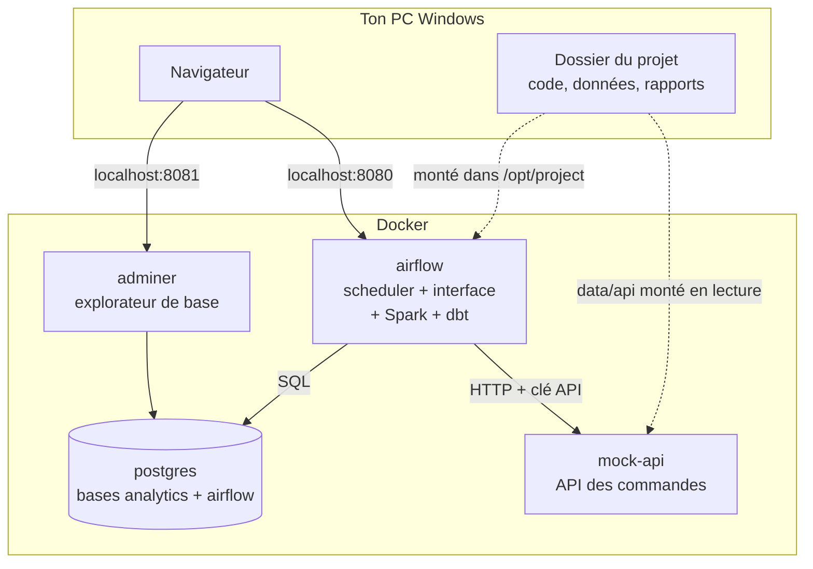
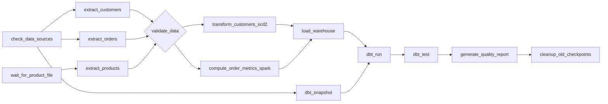

# Architecture du pipeline

## 1. Vue d'ensemble : quatre conteneurs



- **postgres** contient deux bases : `analytics` (la source `customers` et l'entrepôt) et `airflow` (les métadonnées d'Airflow : exécutions, états des tâches).
- **mock-api** remplace l'API du cours (`https://api.example.com/orders` n'existe pas). Il sert `data/api/orders.json` avec pagination, authentification et pannes simulables.
- **airflow** exécute le DAG. Son image ajoute Java (pour Spark), PySpark, les dépendances du pipeline et dbt dans un environnement Python séparé.
- **adminer** permet d'explorer la base depuis le navigateur.

Le code n'est pas copié dans l'image : le dossier du projet est **monté** dans le conteneur. Une modification d'un fichier Python sur ton PC est prise en compte à l'exécution suivante, sans reconstruire l'image.

---

## 2. Le DAG : 14 tâches



| Tâche | Opérateur | Ce qu'elle fait | Écrit |
|---|---|---|---|
| `check_data_sources` | Python | vérifie que PostgreSQL et l'API répondent | rien |
| `wait_for_product_file` | FileSensor | attend `data/input/products.csv` (5 min max) | rien |
| `extract_customers` | Python | clients modifiés depuis le watermark (requête paramétrée, lecture par lots) | `raw_customers.parquet` |
| `extract_orders` | Python | commandes depuis le watermark (pagination, relances), JSON aplati en 2 tables | `raw_orders.parquet`, `raw_order_items.parquet`, réponse brute JSON |
| `extract_products` | Python | catalogue CSV (réparation du format, contrôle du schéma), ignoré si inchangé | `raw_products.parquet` |
| `dbt_snapshot` | Bash | SCD2 natif de dbt sur la table source | `dbt_snapshots.snap_customers` |
| `validate_data` | Python | nettoyage + contrôles qualité + décision (porte qualité), sans relance | `validated_*.parquet`, `validation_results.json` |
| `transform_customers_scd2` | Python | compare les clients à la dimension, calcule les versions à fermer et à créer | `scd2_to_insert.parquet`, `scd2_to_update.parquet` |
| `compute_order_metrics_spark` | Bash (`spark-submit`) | agrégats par jour et client, par jour et produit | `fact_*.parquet` |
| `load_warehouse` | Python | écrit tout en une transaction, puis avance les watermarks | tables PostgreSQL, `watermarks.json` |
| `dbt_run` | Bash | construit les vues de staging et les tables d'analyse | schémas `dbt_staging`, `dbt_marts` |
| `dbt_test` | Bash | 24 tests de cohérence | rien (échec si erreur) |
| `generate_quality_report` | Python | rapport JSON + Markdown, lecture des XCom | `data/output/reports/<run_id>/` |
| `cleanup_old_checkpoints` | Python | supprime les checkpoints de plus de 7 jours | rien |

Les fichiers `.parquet` et `.json` de la colonne « Écrit » sont dans `data/checkpoints/<run_id>/`.

Réglages communs à toutes les tâches : 2 relances avec une attente qui double à chaque fois (de l'ordre de 1 puis 2 minutes dans Docker, 5 puis 10 minutes par défaut ; Airflow y ajoute un peu d'aléa), arrêt d'une tâche bloquée au bout de 30 min, alerte en cas d'échec définitif. Le DAG entier doit finir en 2 h.

---

## 3. Le modèle de données

### Base `analytics`, schéma `public` (créé par `sql/init/01_init_database.sql`)

| Table | Grain (une ligne =) | Clé | Alimentée par |
|---|---|---|---|
| `customers` | un client (état actuel) | `customer_id` | l'application (source simulée) |
| `raw_products` | un produit | `product_id` | `load_warehouse` (UPSERT) |
| `raw_orders` | une commande | `order_id` | `load_warehouse` (UPSERT) |
| `raw_order_items` | une ligne de commande | `order_id`, `line_number` | `load_warehouse` (remplacement par commande) |
| `dim_customers` | une **version** d'un client | `dim_customer_key` | `load_warehouse` (SCD2) |
| `fact_daily_orders` | un jour et un client | `order_date`, `customer_id` | `load_warehouse` (UPSERT) |
| `fact_product_performance` | un jour et un produit | `order_date`, `product_id` | `load_warehouse` (UPSERT) |

Ajouts au script du cours (signalés `[AJOUT]` dans le fichier) : les tables `raw_*` et `fact_product_performance`, les colonnes de lignage `run_id`, `updated_at`, `loaded_at`, un index unique « une seule version courante par client », une contrainte sur l'ordre des dates et des index pour l'extraction incrémentale.

### Schémas créés par dbt

| Objet | Type | Contenu |
|---|---|---|
| `dbt_staging.stg_orders`, `stg_order_items`, `stg_products`, `stg_customer_versions` | vues | tables brutes renommées et typées |
| `dbt_marts.fct_orders_enriched` | table **incrémentale** | une ligne par commande, avec le statut du client à la date de la commande |
| `dbt_marts.mart_daily_sales_by_segment` | table | ventes par jour et par segment client (exigence « Daily Order Facts ») |
| `dbt_marts.mart_product_performance` | table | ventes, part du chiffre d'affaires, rang, tendance sur 30 jours |
| `dbt_snapshots.snap_customers` | snapshot | historique SCD2 construit par dbt |

---

## 4. Les fichiers sur le disque

```
data/
├── input/products.csv          catalogue du cours (format mal formé conservé volontairement)
├── api/orders.json             commandes servies par l'API simulée
├── samples_cours/              fichiers d'exemple du cours, utilisés par les tests
├── checkpoints/<run_id>/       état et données intermédiaires de chaque exécution
├── state/watermarks.json       watermarks partagés entre exécutions
└── output/
    ├── reports/<run_id>/       rapport d'exécution (JSON) et de qualité (Markdown)
    └── alerts/                 une alerte JSON par succès ou échec du DAG
```

Seuls `input/`, `api/` et `samples_cours/` font partie du projet. Le reste est produit à l'exécution (et ignoré par Git, voir `.gitignore`).

---

## 5. Les choix techniques et leurs compromis

**pandas pour l'ingestion, Spark pour les agrégats.** Le code de départ du cours est écrit en pandas, et les volumes demandés (100 000 lignes) tiennent largement en mémoire : la mesure donne 8 s pour 100 000 enregistrements. Spark sert aux agrégats, l'étape qui grossirait le plus avec l'historique. Le même calcul existe en pandas (`ORDER_METRICS_ENGINE=pandas`, valeur par défaut hors Docker) et un test garantit que les deux moteurs donnent le même résultat.

**Des fichiers Parquet entre les tâches, pas des XCom.** Les XCom sont stockés dans la base de métadonnées d'Airflow et ne sont pas faits pour des données. Les tâches s'échangent donc des fichiers dans un dossier commun à l'exécution (`run_id`), et les XCom ne transportent que des métadonnées (nombre de lignes, mode). En production, ce dossier serait un stockage objet (S3, GCS, Azure Blob).

**Un fichier d'état par étape.** Plusieurs tâches Airflow tournent en même temps dans des processus différents : un fichier d'état commun serait écrasé par la dernière tâche à écrire.

**Watermarks dans un fichier JSON.** C'est simple et lisible. En production on les mettrait dans une table de la base, mise à jour dans la même transaction que les données : aujourd'hui, un plantage entre le COMMIT et l'écriture du fichier ferait seulement relire les mêmes données à l'exécution suivante, sans dommage grâce à l'idempotence.

**Dates d'effet au jour près.** Le script du cours utilise le type `DATE`. Deux changements d'un même client le même jour produisent donc une version de durée nulle (début = fin), conservée pour l'audit mais jamais sélectionnée par une jointure point-in-time. Un type `TIMESTAMP` lèverait cette limite.

**Suppressions détectées seulement en rechargement complet.** Une extraction incrémentale ne voit pas les lignes supprimées. La détection est désactivée si des lignes ont été mises en quarantaine, sinon elles passeraient pour supprimées.

**Airflow en mode `standalone`.** Un seul conteneur, idéal pour développer et apprendre. En production : composants séparés (scheduler, api-server, workers) avec CeleryExecutor ou KubernetesExecutor.

**dbt dans un environnement Python séparé.** Les dépendances de dbt et d'Airflow entrent souvent en conflit ; c'est la pratique recommandée.

**Version d'Airflow.** Le cours utilise Airflow 2.8.1, dont le support est terminé. Le projet utilise la version actuelle (3.3.2) et le DAG reste compatible avec Airflow 2.

---

## 6. Sécurité

- Aucun secret dans le code : mots de passe et clé API viennent du fichier `.env` (jamais versionné) ou des variables d'environnement.
- Les mots de passe n'apparaissent pas dans les logs (`repr=False` dans `config.py`).
- Requêtes SQL paramétrées (`%s`) et noms de tables assemblés avec `psycopg2.sql` : pas d'injection SQL possible.
- La clé API passe dans un en-tête HTTP, jamais dans l'URL (qui finit dans les logs des serveurs).
- L'utilisateur `pipeline_user` n'a que les droits nécessaires (lecture, insertion, mise à jour, et suppression sur la seule table `raw_order_items`).

Les mots de passe par défaut (`secure_password`, `admin`) conviennent à un environnement local, pas à un serveur accessible depuis Internet.

---

## 7. Limites connues et pistes d'amélioration

- **Commandes modifiées après coup** : le filtre de l'API porte sur la date de commande. Une vraie API exposerait un champ `updated_at` à utiliser comme watermark.
- **Historique des prix** : le catalogue est mis à jour en type 1 (écrasement). Un SCD2 sur les produits permettrait d'analyser l'effet des changements de prix.
- **Watermarks transactionnels** : les stocker dans une table PostgreSQL, mise à jour dans la transaction du chargement.
- **Monitoring** : les rapports sont des fichiers. On pourrait les charger dans une table et brancher un tableau de bord (Grafana, Metabase) ou un outil spécialisé (Great Expectations, Soda).
- **Alertes** : le webhook (`ALERT_WEBHOOK_URL`) suffit pour Slack ou Teams ; les e-mails demandent un serveur SMTP.
- **Déploiement** : intégration continue (tests à chaque modification) et images versionnées.
